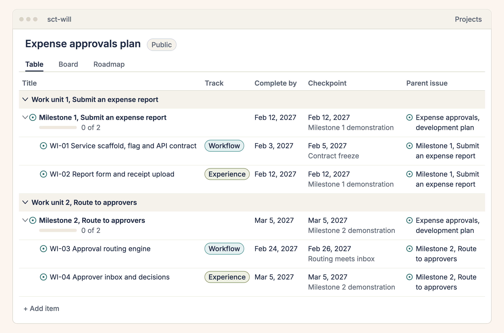

# Expense approvals, a carrydown sample

This is what [carrydown](https://github.com/sct-will/carrydown) made from one document. The ground truth is a short architecture document for a fictional expense approvals service, with its requirements, two governance rules, a development standard and a business analyst note, and the company, the people and the dates are invented. Everything else here is real output of the skills: the plan, one specification per work item, the engineers' skill, and on GitHub the issues and a public project board.

Start with one work item. WI-03, the approval routing engine, is a GitHub issue whose AI engineering notes link to its specification, and that specification cites sections 3.4, 3.5 and 7.1 of the document. That chain, from issue to specification to paragraph, is what an engineer's coding agent reads before it changes code.

[](https://github.com/sct-will/carrydown-sample/issues/9)

**Look.** Open the [public board](https://github.com/users/sct-will/projects/2), click WI-03, then follow its specification link to the sections it cites. No account and no install.

**Try.** [Open carrydown in a Codespace](https://codespaces.new/sct-will/carrydown), a ready-made computer in your browser. As it starts it runs the checker on a copy of this sample and prints the schedule, the load table and the critical path, then a dry run of the issues it would create.

**Install.** Run `npx skills add sct-will/carrydown` in a project folder, put `ground-truth/architecture.md` from this repository in `docs/source/`, and tell your agent "Set up a project plan from this document." Compare your plan with this one. Nothing is written to GitHub until you say yes.

## Renderings

These are renderings of the live sample output, drawn from this repository's plan and the issues as they are on GitHub, in the style used by the carrydown documentation. Every id, title, date and number in them is checked against the plan and the issues when they are built.



*The board as a table, grouped by work unit. The live board has the same fields; group it by Work unit to see this layout.*


*Rendering of the sample output: one issue and the spec file the agent reads first.*

## Live links

- The issues the skills created: https://github.com/sct-will/carrydown-sample/issues. The Epic is issue 1, the five sub-epics are issues 2 to 6 and the nine work items are issues 7 to 15.
- The public project board: https://github.com/users/sct-will/projects/2

The Epic's roll-up comment on issue 1 opens with a Constraints block: the target delivery, and the people and their allocation by track. Every sub-epic carries a target delivery line. The issue bodies were rewritten from the specifications after the dates of WI-02 (2027-02-10), WI-03 (2027-02-19), WI-04 (2027-03-03), WI-06 (2027-03-08) and WI-08 (2027-03-17) moved, and the board carries the new dates.

## The dry run

Before anything was written to GitHub, the dry run printed this summary line.

```text
1 Epic, 5 sub-epics, 9 work item issues
```

After the write, the verification step checked the counts through GitHub.

| Thing | Count |
| --- | --- |
| Labels | 4 |
| Epic | 1 (issue 1) |
| Sub-epics | 5 (issues 2 to 6) |
| Work item issues | 9 (issues 7 to 15) |
| Sub-issue links | 14 |
| Board items | 15 |
| Board fields filled | Work unit on 14, Track on 9, Complete by on 14, Checkpoint on 14 |
| Board views | Table, Board, Roadmap |
| Work unit iterations | 5, with the pause week left as a break |

## Plan

The checker's report on the plan: the schedule, the load table, the critical path, the target, the fit of each item in its window, the earliest finish, the external items, the checkpoints and the planning review. The checker found 15 files clean and 0 findings.

```text
Plan: Expense approvals

Schedule
  Work unit 1, Submit an expense report: 2027-02-01 to 2027-02-12 (demonstration 2027-02-12)
  Work unit 2, Route to approvers: 2027-02-15 to 2027-03-05 (demonstration 2027-03-05)
  Work unit 3, Enforce policy: 2027-03-08 to 2027-03-19 (demonstration 2027-03-19)
  Work unit 4, Pilot with one team: 2027-03-29 to 2027-04-09 (demonstration 2027-04-09)
  Work unit 5, Release: 2027-04-12 to 2027-04-23 (demonstration 2027-04-23)
  Break, Offsite and planning week: 2027-03-22 to 2027-03-26

Load (sized days of work against allocated capacity, per person and work unit)
  Capacity is the working days a person has in the work unit, minus days off, times their percent allocation.
  Person  Alloc  WU1             WU2             WU3             WU4             WU5            Total          
  tamsin  100%   3 of 10d (30%)  5 of 14d (36%)  6 of 10d (60%)  4 of 10d (40%)  0 of 10d       18 of 54d (33%)
  idris   60%    3 of 6d (50%)   4 of 9d (44%)   4 of 5d (74%)   0 of 6d         3 of 6d (50%)  14 of 32d (43%)
  No person is over 100 percent of allocated capacity in any work unit.

Critical path (longest dependency chain to the last item)
  WI-01 -> WI-02 -> WI-04 -> WI-08 -> WI-11  (79 calendar days)
    WI-01 Service scaffold, flag and API contract, by 2027-02-03, tamsin
    WI-02 Report form and receipt upload, by 2027-02-10, idris
    WI-04 Approver inbox and decisions, by 2027-03-03, idris
    WI-08 Notifications and delegates, by 2027-03-17, idris
    WI-11 Release readiness and runbook, by 2027-04-21, idris

Target
  Target: 2027-04-23
  The critical path ends 2027-04-21: it meets the target with 2 day(s) to spare.

Fit (working days each item needs, from its size and its owner's allocation, against its window)
  Every sized item fits between its last dependency and its complete_by date.

Earliest finish (forward pass over the dependencies, from sizes and allocation)
  WI-01 -> WI-02 -> WI-04 -> WI-08 -> WI-11  ends 2027-03-10
    WI-01 2027-02-01 to 2027-02-03, about 3.0 working days
    WI-02 2027-02-04 to 2027-02-10, about 5.0 working days
    WI-04 2027-02-11 to 2027-02-19, about 6.7 working days
    WI-08 2027-02-22 to 2027-03-02, about 6.7 working days
    WI-11 2027-03-03 to 2027-03-10, about 5.0 working days
  It meets the target 2027-04-23 with 44 day(s) to spare. The planned dates add the slack between items.
  Owners are not serialised in this pass. The load table above shows whether each person's work fits each work unit.

External items (outside the development plan; referenced only as external input)
  WI-05 Pilot team recruitment
  WI-10 Finance sign-off

Checkpoints
  2027-02-05  Contract freeze: WI-01
  2027-02-12  Milestone 1 demonstration: WI-02
  2027-02-26  Routing meets inbox: WI-03
  2027-03-05  Milestone 2 demonstration: WI-04
  2027-03-12  Rules meet routing: WI-06
  2027-03-19  Milestone 3 demonstration: WI-07, WI-08
  2027-04-09  Pilot readout: WI-09
  2027-04-23  Release: WI-11

Planning review (advisory, except lines marked finding; the rules are in references/planning.md)
  Milestone composition (rules 1 to 3)
    Milestone 1, Submit an expense report: Workflow (WI-01), Experience (WI-02).
      The joint check on 2027-02-12 names Workflow and Experience.
    Milestone 2, Route to approvers: Workflow (WI-03), Experience (WI-04).
      The joint check on 2027-03-05 names Workflow and Experience.
    Milestone 3, Enforce policy: Workflow (WI-06, WI-07), Experience (WI-08).
      The joint check on 2027-03-19 names Workflow and Experience.
    Milestone 4, Pilot with one team: Workflow (WI-09) only.
      One track, because: The pilot adds no screen and no notification. The Experience work it needs is support for the pilot team on the existing web client, which is not a deliverable item.
      The joint check on 2027-04-09 names Workflow and Experience.
    Milestone 5, Release: Experience (WI-11) only.
      One track, because: Release readiness is one item of rehearsal and runbook work. It sits on the Experience track because the rehearsal runs through the web client. The Workflow engineer takes part in the rehearsal and owns no new item.
      The joint check on 2027-04-23 names Workflow and Experience.
  Order of work per track (rules 4, 5 and 10)
    Workflow: WI-01, WI-03, WI-06, WI-07, WI-09. Order rationale given.
    Experience: WI-02, WI-04, WI-08, WI-11. Order rationale given.
  Theme switches (consecutive items of one owner, by date)
    tamsin: 1 switch, 0 inside a milestone.
      WI-07 (expense service) to WI-09 (export job), across milestones 3 and 4.
    idris: 2 switches, 0 inside a milestone.
      WI-04 (web client) to WI-08 (notification worker), across milestones 2 and 3.
      WI-08 (notification worker) to WI-11 (release), across milestones 3 and 5.
  Slack before checkpoints (rule 7)
    Every item completes before its checkpoint. The least slack is 2 working day(s), WI-01 before 2027-02-05.
  Critical path owners (rule 8)
    WI-01 -> WI-02 -> WI-04 -> WI-08 -> WI-11: tamsin (WI-01), idris (WI-02, WI-04, WI-08, WI-11).
  Load ratio (rule 6)
    Share of allocated capacity over the plan: tamsin 18 of 54d (33%), idris 14 of 32d (43%).
    Highest to lowest is 1.3 to 1 (idris to tamsin).
  0 finding(s).
```

The sample is a two-person fictional team planned with slack on purpose, so its loads run below the eighty percent aim the method sets for a real team.

## What is here

| Path | What it is | Made by |
| --- | --- | --- |
| [ground-truth/architecture.md](ground-truth/architecture.md) | The source document: context, requirements, architecture, two governance rules, a development standard, a business analyst note, interfaces and risks. | A person |
| [people.yaml](people.yaml), [timeline.yaml](timeline.yaml) | Two people with tracks and percent allocation (one at 100, one at 60), an advisor, a target date of 2027-04-23 and a pause week. | The interview |
| [docs/ground-truth/architecture.md](docs/ground-truth/architecture.md) | The rendering with a section index. | `render_ground_truth.py` |
| [docs/spec/plan.yaml](docs/spec/plan.yaml) | The plan: five milestones, nine work items, two tracks, checkpoints. | A person and the agent |
| [docs/spec/README.md](docs/spec/README.md) | Conventions, schedule, comment templates and the index. | `scaffold_spec.py` |
| [docs/dev/skills/expense-approvals-dev](docs/dev/skills/expense-approvals-dev/SKILL.md) | The engineers' skill for this project. | `generate_dev_skill.py` |
| [tools/carrydown](tools/carrydown/check_specs.py), [.github/workflows/check-specs.yml](.github/workflows/check-specs.yml) | The checker, copied here, and the workflow that runs it in continuous integration when a pull request or a push to main touches the specifications, the ground truth or the checker. | `scaffold_spec.py --ci` |

The milestone files and one specification per work item:

- [Milestone 1, Submit an expense report](docs/spec/m1-submit-report/milestone.md)
  - [WI-01 Service scaffold, flag and API contract](docs/spec/m1-submit-report/wi-01-service-scaffold.md)
  - [WI-02 Report form and receipt upload](docs/spec/m1-submit-report/wi-02-report-form.md)
- [Milestone 2, Route to approvers](docs/spec/m2-route-to-approvers/milestone.md)
  - [WI-03 Approval routing engine](docs/spec/m2-route-to-approvers/wi-03-routing-engine.md)
  - [WI-04 Approver inbox and decisions](docs/spec/m2-route-to-approvers/wi-04-approver-inbox.md)
- [Milestone 3, Enforce policy](docs/spec/m3-enforce-policy/milestone.md)
  - [WI-06 Approval limits and separation of duties](docs/spec/m3-enforce-policy/wi-06-limits-and-duties.md)
  - [WI-07 Audit log and retention](docs/spec/m3-enforce-policy/wi-07-audit-log.md)
  - [WI-08 Notifications and delegates](docs/spec/m3-enforce-policy/wi-08-notifications-delegates.md)
- [Milestone 4, Pilot with one team](docs/spec/m4-pilot/milestone.md)
  - [WI-09 Ledger export job](docs/spec/m4-pilot/wi-09-ledger-export.md)
- [Milestone 5, Release](docs/spec/m5-release/milestone.md)
  - [WI-11 Release readiness and runbook](docs/spec/m5-release/wi-11-release-readiness.md)

Ids 5 and 10 are missing on purpose. They are external items (pilot team recruitment, finance sign-off), owned outside the team, and appear in the specifications only as an "external input".

## Run it again

Clone both repositories side by side. These three commands need no token and no network access to GitHub.

```bash
git clone https://github.com/sct-will/carrydown.git
git clone https://github.com/sct-will/carrydown-sample.git
cd carrydown
python3 scripts/check_specs.py --root ../carrydown-sample --report
python3 scripts/github_sync.py --root ../carrydown-sample --offline
python3 scripts/github_project.py --root ../carrydown-sample --offline
```

To see the dry runs against GitHub, store a token with `python3 scripts/github_token.py` and name a throwaway repository of your own. Both commands are dry runs until you add `--apply`.

```bash
python3 scripts/github_sync.py --root ../carrydown-sample --repo YOUR-USER/YOUR-TEST-REPO
python3 scripts/github_project.py --root ../carrydown-sample --repo YOUR-USER/YOUR-TEST-REPO
```

## Back to carrydown

The skills and scripts are at https://github.com/sct-will/carrydown. The README there explains how to install them and how to use your own document.

## Licence

The scripts in `tools/` are licensed under the Apache License 2.0, see [LICENSE](LICENSE). The ground-truth document, the plan, the specifications, the engineers' skill and the images are licensed under Creative Commons Attribution 4.0 International, see [LICENSE-CONTENT.md](LICENSE-CONTENT.md).
